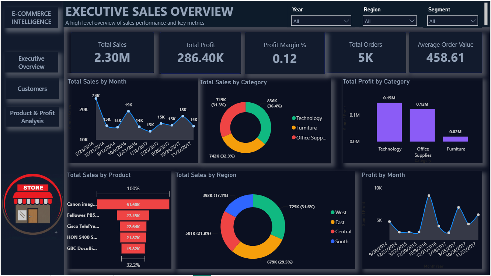
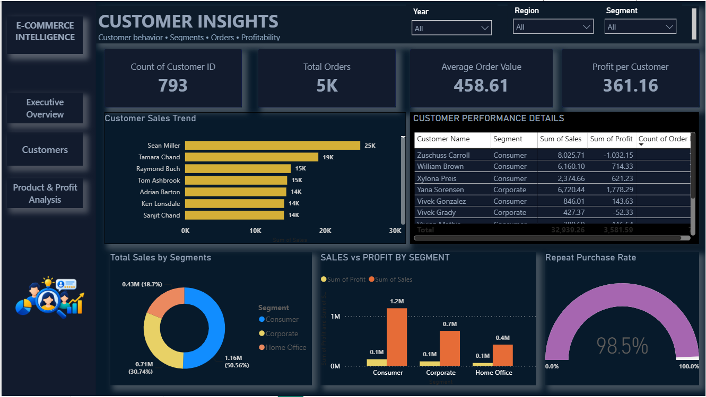
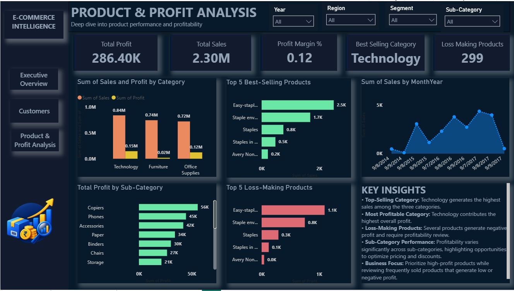

# E-Commerce Sales & Profit Analysis | Power BI

## Project Overview
- An interactive Power BI dashboard analyzing e-commerce sales, customer behavior, product performance, and profitability.

## Dashboard Preview

### 1. Executive Sales Overview

### 2. Customer Insights

### 3. Product & Profit Analysis

## Key Metrics
- **Total Sales:** 2.30M
- **Total Profit:** 286.40K
- **Profit Margin:** 12%
- **Total Orders:** 5K
- **Average Order Value:** 458.61

## Tools & Technologies
- Microsoft Power BI
- Power Query
- DAX
- Data Visualization

## Key Insights
- Technology generates the highest sales and profit.
- Customer and regional performance can be compared.
- Loss-making products can be identified for further analysis.
- Interactive slicers enable dynamic data exploration.

## Files
- `.pbix` — Interactive Power BI report
- `Screenshots/` — Dashboard preview images

**Created using Microsoft Power BI.**